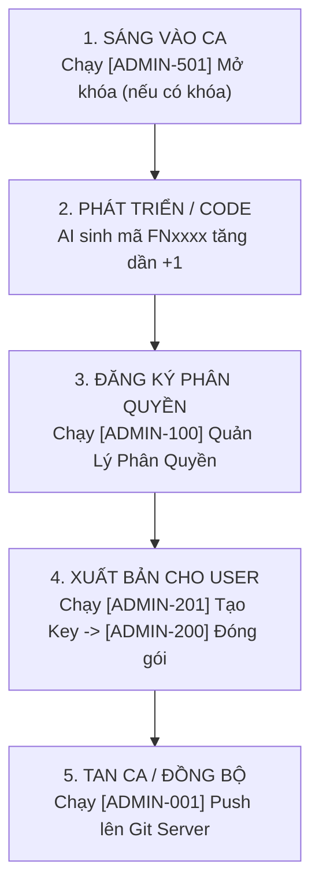

# QUY TRÌNH VẬN HÀNH & VÒNG ĐỜI HỆ THỐNG DÀNH CHO ADMIN
> ⚠️ **TÀI LIỆU TỐI MẬT QUẢN TRỊ - TUYỆT ĐỐI KHÔNG CUNG CẤP CHO CLIENT**  
> 👤 **BẢN QUYỀN:** ĐÀO XUÂN TUẤN (MR. TUẤN BEO - TECHNICAL CONSULTANT)  
> 📁 **VỊ TRÍ:** `@File-BAT/@Administrator/@Huong-Dan-Admin/02-QUY-TRINH-VAN-HANH-VA-VONG-DOI-HE-THONG.md`

---

## 🏛️ I. BẢNG TRA CỨU PHÂN TẦNG KỊCH BẢN [ADMIN-xxx]

Toàn bộ các công cụ quản trị của Admin được sắp xếp theo 5 dải số chuyên biệt:

```text
@File-BAT/@Administrator/
│
├── [ADMIN-001 -> 099] : TẦNG HÀNG NGÀY / GIT & CLOUD SERVER
│   ├── [ADMIN-001]-Push-Source-To-Server.bat   <-- Đẩy mã nguồn & Rule lên GitHub an toàn
│   └── [ADMIN-002]-Xac-Thuc-Dong-Bo-Server.bat <-- Kiểm tra kết nối Cloud Gateway
│
├── [ADMIN-100 -> 199] : TẦNG QUẢN LÝ CHỨC NĂNG & MA TRẬN PHÂN QUYỀN
│   └── [ADMIN-100]-Quan-Ly-Phan-Quyen.bat      <-- Giao diện TUI quản trị ma trận quyền các mã FNxxxx
│
├── [ADMIN-200 -> 299] : TẦNG ĐÓNG GÓI XUẤT XƯỞNG & CẤP BẢN QUYỀN CHO USER
│   ├── [ADMIN-200]-Dong-Goi-Ban-Client.bat     <-- Đóng gói file ZIP sạch cho người dùng (loại trừ Admin)
│   └── [ADMIN-201]-Quan-Ly-Va-Tao-Key.bat      <-- Tạo Key Token RSA cấp phép cho tài khoản User
│
├── [ADMIN-300 -> 499] : TẦNG DỰ PHÒNG MỞ RỘNG TƯƠNG LAI (RESERVED)
│
└── [ADMIN-500 -> 599] : TẦNG VẬN HÀNH ĐẶC THÙ / BẢO MẬT CA KÍP
    ├── [ADMIN-500]-Khoa-Rule-Bao-Ve-Tan-Ca.bat <-- Niêm phong và khóa mã nguồn khi rời máy
    └── [ADMIN-501]-Mo-Khoa-Rule-Vao-Ca.bat     <-- Mở khóa và bắt đầu phiên làm việc mới
```

---

## 🔄 II. QUY TRÌNH 5 BƯỚC VÒNG ĐỜI HÀNG NGÀY CỦA ADMIN



### Bước 1: Sáng bắt đầu ca làm việc
- Nếu ca làm việc trước đó có chạy lệnh khóa bảo vệ: Bấm chạy file **`[ADMIN-501]-Mo-Khoa-Rule-Vao-Ca.bat`**.
- Kéo mã nguồn mới nhất về (nếu tối qua có sửa ở máy nhà): Chạy lệnh `git pull` hoặc `[05]-Cap-Nhat-Rule-Tu-Server.bat`.

### Bước 2: Thêm mới chức năng / Quy tắc
- Khi tạo chức năng mới trong Toolbox hoặc Rule mới trong AI:
  * Xác định đúng phân hệ (`00` System, `01` Frontend, `02` Backend, `03` Config, `09` Database).
  * Tra cứu `02_FUNCTIONS.md` và sinh mã **`FN[GG][NN]` tăng tuần tự +1 theo đúng nhóm đó (`Group_Max + 1`)**.
  * Kiểm tra đối soát chống trùng lặp mã trước khi ghi nhận. Tuyệt đối không lấy `FN9999` để tăng.
  * Trạng thái mặc định: Tắt (`0`) cho nhóm thường, Bật (`1`) cho Admin.

### Bước 3: Điều phối ma trận phân quyền
- Bấm chạy: **`[ADMIN-100]-Quan-Ly-Phan-Quyen.bat`**.
- Nhấn phím số tương ứng (hoặc gõ mã `FNxxxx`) để Bật (`XANH`) hoặc Tắt (`XÁM`) quyền sử dụng chức năng đó cho từng nhóm đối tượng.
- Bấm `[S]` để lưu ma trận có gắn mã băm toàn vẹn.

### Bước 4: Đóng gói và Cấp phát cho Khách hàng / Nhân viên
- Cấp quyền cho User mới: Chạy **`[ADMIN-201]-Quan-Ly-Va-Tao-Key.bat`** để sinh License Token gắn với HWID của máy khách.
- Đóng gói bộ cài đặt: Chạy **`[ADMIN-200]-Dong-Goi-Ban-Client.bat`**.  
  *(Hệ thống tự động loại trừ 100% thư mục `@Administrator`, tài liệu tối mật và các file quản lý hệ thống trước khi nén thành file ZIP siêu nhẹ)*.

### Bước 5: Chiều tan ca / Đẩy bản cập nhật lên GitHub
- Bấm chạy: **`[ADMIN-001]-Push-Source-To-Server.bat`**.
- Script tự động kiểm tra thay đổi, đối soát tính toàn vẹn và đẩy commit an toàn lên GitHub Server riêng của Anh Beo.
- Nếu rời khỏi văn phòng: Bấm chạy **`[ADMIN-500]-Khoa-Rule-Bao-Ve-Tan-Ca.bat`** để niêm phong kho mã nguồn.
